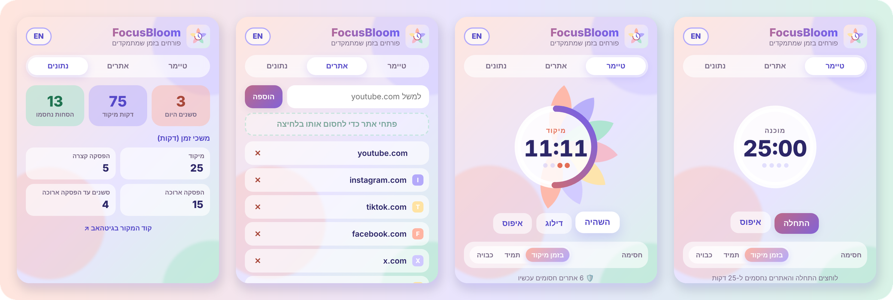
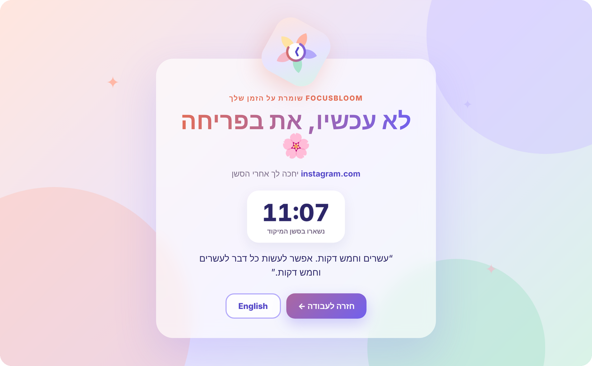
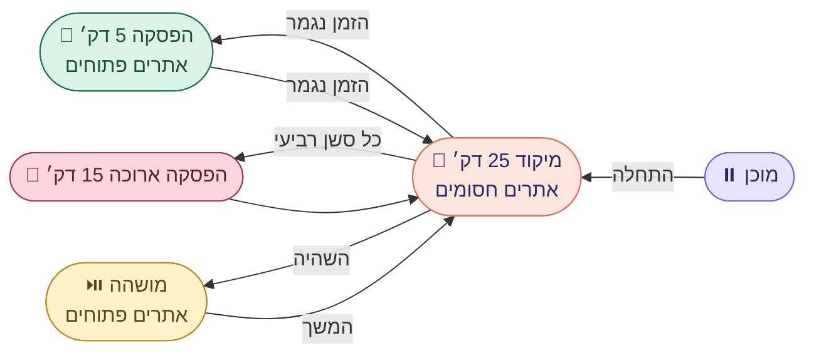

<div dir="rtl">

<p align="center">
  <a href="#install"></a>
</p>

<p align="center"><a href="README.md"></a></p>

<p align="center">
  <a href="#install"></a>
  <a href="#how-it-works"></a>
  <a href="src"></a>
</p>

<p align="center">
  <a href="https://github.com/NoyaAdivi/FocusBloom/actions/workflows/tests.yml"></a>
  <a href="https://developer.chrome.com/docs/extensions/develop/migrate/what-is-mv3"></a>
  <a href="LICENSE"></a>
  <a href="https://github.com/NoyaAdivi/FocusBloom/commits/main"></a>
  <a href="https://github.com/NoyaAdivi/FocusBloom"></a>
</p>

<h3 align="center">מתמקדים 25 דקות. הסחות הדעת מחכות בחוץ.</h3>

<p align="center">
  FocusBloom הוא תוסף לכרום שמחבר <b>טיימר פומודורו</b> ו<b>חוסם אתרים</b>.<br>
  יוטיוב, אינסטגרם והחברים שלהם נחסמים <b>רק בזמן המיקוד</b>, ונפתחים שוב ברגע שההפסקה מתחילה.
</p>

<table align="center" dir="rtl">
  <tr>
    <td align="center" width="25%"><a href="#how-it-works"><b>🍅 25 · 5 · 15</b></a><br><sub>מיקוד, הפסקה, הפסקה ארוכה</sub></td>
    <td align="center" width="25%"><a href="src/logic.js"><b>🛡️ 3 מצבים</b></a><br><sub>בזמן מיקוד, תמיד, כבוי</sub></td>
    <td align="center" width="25%"><a href="README.md"><b>🌍 HE · EN</b></a><br><sub>ממשק מלא בעברית מימין לשמאל</sub></td>
    <td align="center" width="25%"><a href="https://github.com/NoyaAdivi/FocusBloom/actions/workflows/tests.yml"><b>🧪 CI</b></a><br><sub>בדיקות בכל דחיפה</sub></td>
  </tr>
</table>

<a name="highlights"></a>
<p align="center"><a href="#see-it-in-action"></a></p>

<table dir="rtl">
  <tr valign="top">
    <td valign="top" width="33%" dir="rtl">
      <p><b>🍅 טיימר שעושה את העבודה</b></p>
      <ul>
        <li><a href="src/popup/popup.js"><b>טיימר שפורח</b></a>: עלה כותרת נפתח עם כל דקה של מיקוד</li>
        <li><b>הפסקות קצרות וארוכות</b> אוטומטיות, הפסקה ארוכה כל 4 סשנים</li>
        <li><b>ממשיך לרוץ</b> גם כשהחלון סגור, עם מונה חי על האייקון</li>
        <li><b>התראות</b> כשהמיקוד או ההפסקה נגמרים</li>
      </ul>
    </td>
    <td valign="top" width="33%" dir="rtl">
      <p><b>🛡️ חסימה הוגנת</b></p>
      <ul>
        <li><a href="src/background.js"><b>חסימה רק בזמן מיקוד</b></a>, או תמיד אם בוחרים</li>
        <li><b>גם תתי דומיינים:</b> חסימת youtube.com חוסמת גם את m.youtube.com</li>
        <li><b>טאבים פתוחים נתפסים</b> ברגע שהסשן מתחיל</li>
        <li><a href="src/blocked/blocked.html"><b>דף חסימה נעים</b></a> שמראה כמה זמן נשאר ומחזיר לאתר כשההפסקה מתחילה</li>
      </ul>
    </td>
    <td valign="top" width="33%" dir="rtl">
      <p><b>💛 נבנה בתשומת לב</b></p>
      <ul>
        <li><b>לחיצה אחת</b> חוסמת את האתר שנמצאים בו</li>
        <li><b>נתונים יומיים:</b> סשנים, דקות מיקוד והסחות שנחסמו</li>
        <li><b>עברית ואנגלית</b> עם פריסה מלאה מימין לשמאל</li>
        <li><b>מצב כהה</b> 🌙 שעוקב אחרי המערכת, או שבוחרים לבד</li>
        <li><a href="tests/logic.test.js"><b>לוגיקה עם בדיקות</b></a> וקיצור מקלדת (<kbd>Alt</kbd>+<kbd>Shift</kbd>+<kbd>F</kbd>)</li>
      </ul>
    </td>
  </tr>
</table>

<a name="see-it-in-action"></a>
<p align="center"><a href="#how-it-works"></a></p>

<p align="center">
  <a href="src/popup"></a>
</p>

<p align="center">
  <a href="src/blocked"></a>
</p>

<p align="center">
  <a href="src/popup/popup.html"><b>חלון קופץ</b></a> ·
  <a href="src/blocked/blocked.html"><b>דף חסימה</b></a> ·
  <a href="src/background.js"><b>Service worker</b></a> ·
  <a href="src/logic.js"><b>לוגיקה</b></a> ·
  <a href="manifest.json"><b>Manifest</b></a>
</p>

<a name="how-it-works"></a>
<p align="center"><a href="#install"></a></p>

</div>



<div dir="rtl">

1. ה־**service worker** ([`background.js`](src/background.js)) מנהל את הטיימר. הוא שומר את `endsAt` ב־`chrome.storage` וקובע שעון מעורר אחד של `chrome.alarms`, כך שהטיימר שורד גם חלון סגור וגם service worker שנרדם.
2. כשהמיקוד מתחיל הוא כותב **חוקי `declarativeNetRequest`** שנבנים ב־[`buildRules()`](src/logic.js). כרום עצמו מפנה את האתרים החסומים לדף החסימה, כך שאף אחד לא צריך לקרוא את הגלישה שלך.
3. כשהשעון המעורר מצלצל, החוקים נמחקים, קופצת הודעה והשלב הבא מתחיל.
4. כל ההחלטות נמצאות בפונקציות טהורות ב־[`logic.js`](src/logic.js), ולכן אפשר [לבדוק אותן ב־Node](tests/logic.test.js) בלי דפדפן.

<details>
<summary><b>🔐 ההרשאות ולמה צריך כל אחת</b></summary>
<br>

| הרשאה | למה |
|---|---|
| [`declarativeNetRequest`](https://developer.chrome.com/docs/extensions/reference/api/declarativeNetRequest) | להפנות אתרים חסומים בזמן מיקוד |
| [`alarms`](https://developer.chrome.com/docs/extensions/reference/api/alarms) | לסיים כל סשן והפסקה בזמן |
| [`storage`](https://developer.chrome.com/docs/extensions/reference/api/storage) | לשמור אתרים, הגדרות ונתונים אצלך במחשב |
| [`notifications`](https://developer.chrome.com/docs/extensions/reference/api/notifications) | להודיע כשמיקוד או הפסקה נגמרים |
| [`tabs`](https://developer.chrome.com/docs/extensions/reference/api/tabs) | לחסום בלחיצה את האתר הפתוח, ולתפוס טאבים שכבר פתוחים |
| [`<all_urls>`](https://developer.chrome.com/docs/extensions/develop/concepts/declare-permissions) | כדי שההפניה תעבוד על כל אתר שמוסיפים |
</details>

<a name="install"></a>
<p align="center"><a href="#tech-stack"></a></p>

1. **מורידים את הקוד:** [הורדת ZIP](https://github.com/NoyaAdivi/FocusBloom/archive/refs/heads/main.zip) ופותחים אותו, או משכפלים:

</div>

```bash
git clone https://github.com/NoyaAdivi/FocusBloom.git
```

<div dir="rtl">

2. פותחים את כרום ונכנסים ל־`chrome://extensions`
3. מדליקים את **Developer mode** (למעלה בצד).
4. לוחצים **Load unpacked** ובוחרים את התיקייה `FocusBloom` (זו שיש בה `manifest.json`).
5. נועצים את האייקון 🌸, לוחצים **התחלה**, ומתמקדים.

> [!TIP]
> רוצים להריץ את הבדיקות? עם [Node.js](https://nodejs.org) גרסה 20 ומעלה מריצים `npm test`. אין חבילות להתקין.

<a name="tech-stack"></a>
<p align="center"><a href="#privacy"></a></p>

<p align="center"><b>התוסף</b><br>
<a href="https://developer.chrome.com/docs/extensions/develop/migrate/what-is-mv3"></a>
<a href="https://developer.chrome.com/docs/extensions/reference/api/declarativeNetRequest"></a>
<a href="https://developer.chrome.com/docs/extensions/reference/api/alarms"></a>
</p>

<p align="center"><b>קוד</b><br>
<a href="https://developer.mozilla.org/en-US/docs/Web/JavaScript"></a>
<a href="https://developer.mozilla.org/en-US/docs/Web/HTML"></a>
<a href="https://developer.mozilla.org/en-US/docs/Web/CSS/CSS_animations"></a>
<a href="https://developer.mozilla.org/en-US/docs/Web/SVG"></a>
</p>

<p align="center"><b>איכות</b><br>
<a href="https://nodejs.org/api/test.html"></a>
<a href="https://github.com/NoyaAdivi/FocusBloom/actions"></a>
</p>

</div>

<details dir="rtl">
<summary><b>📂 מבנה הפרויקט</b></summary>

```
├── manifest.json          ההגדרות וההרשאות של התוסף
├── src/
│   ├── background.js      service worker: טיימר, התראות, חוקי חסימה, הודעות
│   ├── logic.js           פונקציות טהורות: דומיינים, חוקים, שלבים, זמן (עם בדיקות)
│   ├── popup/             החלון הקופץ: טיימר, אתרים, נתונים
│   ├── blocked/           הדף שמופיע באתר חסום
│   └── icons/             הלוגו ב־SVG וב־PNG
├── tests/logic.test.js    בדיקות יחידה עם node:test
├── docs/                  תמונות וכותרות מונפשות ל־README
└── .github/workflows/     CI שמריץ את הבדיקות בכל דחיפה
```
</details>

<div dir="rtl">

<a name="privacy"></a>
<p align="center"><a href="#contact"></a></p>

<p align="center">
  בלי חשבונות, בלי שרתים ובלי מעקב. האתרים, ההגדרות והנתונים נשמרים רק ב־<code>chrome.storage</code> אצלך במחשב.<br>
  FocusBloom אף פעם לא קורא את הדפים שנכנסים אליהם. כרום עושה את החסימה לפי החוקים שהתוסף נותן לו.
</p>

<a name="contact"></a>
<p align="center"><a href="https://www.linkedin.com/in/noya-adivi/"></a></p>

<p align="center">
  <a href="https://www.linkedin.com/in/noya-adivi/"></a>
  <a href="https://noyaadivi.github.io/noya-website"></a>
  <a href="https://github.com/NoyaAdivi/Okeat"></a>
  <a href="https://github.com/NoyaAdivi"></a>
</p>

</div>
