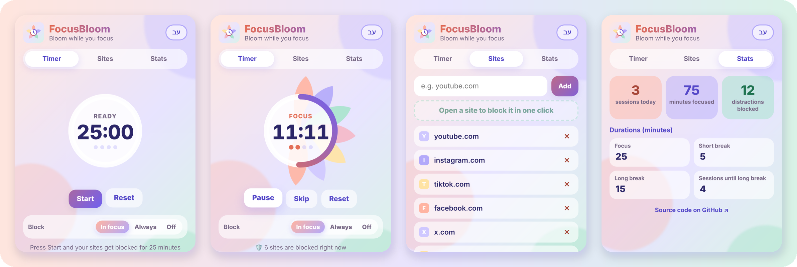
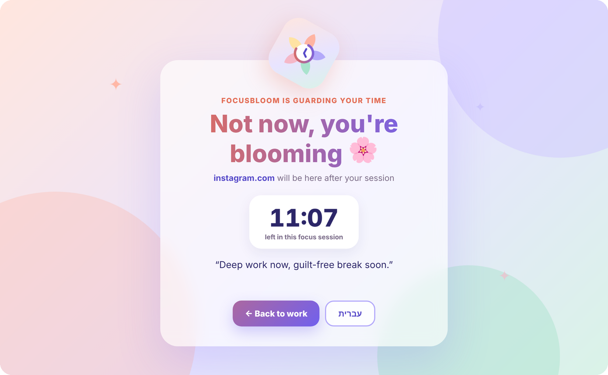
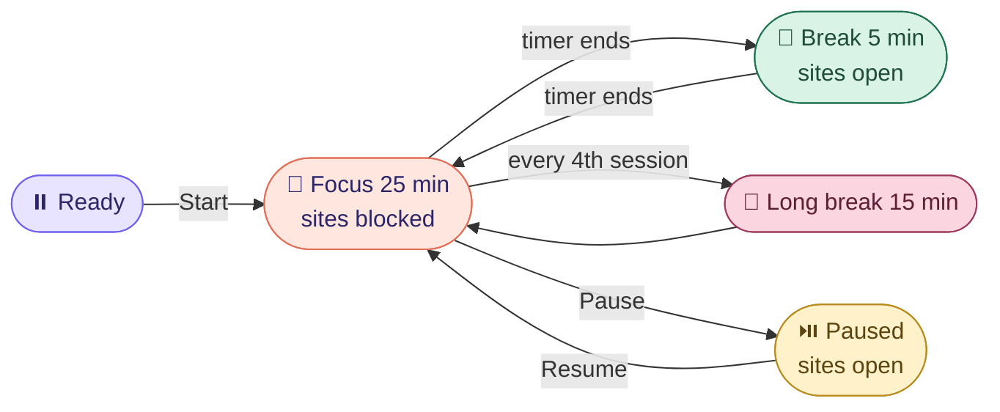

<p align="center">
  <a href="#install"></a>
</p>

<p align="center"><a href="README.he.md"></a></p>

<p align="center">
  <a href="#install"></a>
  <a href="#how-it-works"></a>
  <a href="src"></a>
</p>

<p align="center">
  <a href="https://github.com/NoyaAdivi/FocusBloom/actions/workflows/tests.yml"></a>
  <a href="https://developer.chrome.com/docs/extensions/develop/migrate/what-is-mv3"></a>
  <a href="LICENSE"></a>
  <a href="https://github.com/NoyaAdivi/FocusBloom/commits/main"></a>
  <a href="https://github.com/NoyaAdivi/FocusBloom"></a>
</p>

<h3 align="center">Focus for 25 minutes. Your distractions wait outside.</h3>

<p align="center">
  FocusBloom is a Chrome extension that combines a <b>Pomodoro timer</b> and a <b>site blocker</b>.<br>
  YouTube, Instagram and friends are blocked <b>only while you focus</b> and open again the moment your break starts.
</p>

<table align="center">
  <tr>
    <td align="center" width="25%"><a href="#how-it-works"><b>🍅 25 · 5 · 15</b></a><br><sub>focus, break, long break</sub></td>
    <td align="center" width="25%"><a href="src/logic.js"><b>🛡️ 3 modes</b></a><br><sub>in focus, always, off</sub></td>
    <td align="center" width="25%"><a href="README.he.md"><b>🌍 HE · EN</b></a><br><sub>full RTL Hebrew interface</sub></td>
    <td align="center" width="25%"><a href="https://github.com/NoyaAdivi/FocusBloom/actions/workflows/tests.yml"><b>🧪 CI</b></a><br><sub>tests on every push</sub></td>
  </tr>
</table>

<a name="highlights"></a>
<p align="center"><a href="#see-it-in-action"></a></p>

<table>
  <tr valign="top">
    <td valign="top" width="33%">
      <p><b>🍅 A timer that does the work</b></p>
      <ul>
        <li><a href="src/popup/popup.js"><b>Blooming timer</b></a>: a petal opens with every minute you focus</li>
        <li><b>Automatic short and long breaks</b>, with a long one every 4 sessions</li>
        <li><b>Keeps running</b> when the popup is closed, with a live badge on the icon</li>
        <li><b>Notifications</b> when focus or a break ends</li>
      </ul>
    </td>
    <td valign="top" width="33%">
      <p><b>🛡️ Blocking that is fair</b></p>
      <ul>
        <li><a href="src/background.js"><b>Blocked only during focus</b></a>, or always if you choose</li>
        <li><b>Subdomains too:</b> blocking youtube.com also blocks m.youtube.com</li>
        <li><b>Open tabs are caught</b> the second a session starts</li>
        <li><a href="src/blocked/blocked.html"><b>A friendly blocked page</b></a> that shows the time left and sends you back when the break starts</li>
      </ul>
    </td>
    <td valign="top" width="33%">
      <p><b>💛 Made with care</b></p>
      <ul>
        <li><b>One click</b> blocks the site you are on</li>
        <li><b>Daily stats:</b> sessions, focus minutes and blocked distractions</li>
        <li><b>Hebrew and English</b> with a full right-to-left layout</li>
        <li><b>Dark mode</b> 🌙 that follows your system, or pick it yourself</li>
        <li><a href="tests/logic.test.js"><b>Unit tested</b></a> logic and a keyboard shortcut (<kbd>Alt</kbd>+<kbd>Shift</kbd>+<kbd>F</kbd>)</li>
      </ul>
    </td>
  </tr>
</table>

<a name="see-it-in-action"></a>
<p align="center"><a href="#how-it-works"></a></p>

<p align="center">
  <a href="src/popup"></a>
</p>

<p align="center">
  <a href="src/blocked"></a>
</p>

<p align="center">
  <a href="src/popup/popup.html"><b>Popup</b></a> ·
  <a href="src/blocked/blocked.html"><b>Blocked page</b></a> ·
  <a href="src/background.js"><b>Service worker</b></a> ·
  <a href="src/logic.js"><b>Logic</b></a> ·
  <a href="manifest.json"><b>Manifest</b></a>
</p>

<a name="how-it-works"></a>
<p align="center"><a href="#install"></a></p>



1. The **service worker** ([`background.js`](src/background.js)) owns the timer. It saves `endsAt` in `chrome.storage` and sets one `chrome.alarms` alarm, so the timer survives a closed popup and even a sleeping service worker.
2. When focus starts it writes **`declarativeNetRequest` rules** built by [`buildRules()`](src/logic.js). Chrome itself redirects blocked sites to the blocked page, so nothing has to read your browsing.
3. When the alarm fires the rules are removed, a notification pops up and the next phase starts.
4. All the decisions live in pure functions in [`logic.js`](src/logic.js), which is why they can be [tested in Node](tests/logic.test.js) without a browser.

<details>
<summary><b>🔐 Permissions and why each one is needed</b></summary>
<br>

| Permission | Why |
|---|---|
| [`declarativeNetRequest`](https://developer.chrome.com/docs/extensions/reference/api/declarativeNetRequest) | Redirect blocked sites while you focus |
| [`alarms`](https://developer.chrome.com/docs/extensions/reference/api/alarms) | End each focus session and break on time |
| [`storage`](https://developer.chrome.com/docs/extensions/reference/api/storage) | Save your sites, settings and stats on your computer |
| [`notifications`](https://developer.chrome.com/docs/extensions/reference/api/notifications) | Tell you when focus or a break ends |
| [`tabs`](https://developer.chrome.com/docs/extensions/reference/api/tabs) | Block the site you are on in one click, and catch tabs that are already open |
| [`<all_urls>`](https://developer.chrome.com/docs/extensions/develop/concepts/declare-permissions) | Needed so the redirect works on any site you add |
</details>

<a name="install"></a>
<p align="center"><a href="#tech-stack"></a></p>

1. **Get the code:** [download the ZIP](https://github.com/NoyaAdivi/FocusBloom/archive/refs/heads/main.zip) and unzip it, or clone it:
   ```bash
   git clone https://github.com/NoyaAdivi/FocusBloom.git
   ```
2. Open Chrome and go to `chrome://extensions`
3. Turn on **Developer mode** (top right).
4. Click **Load unpacked** and choose the `FocusBloom` folder (the one with `manifest.json`).
5. Pin the 🌸 icon, press **Start**, and focus.

> [!TIP]
> Want to run the tests? With [Node.js](https://nodejs.org) 20 or newer run `npm test`. No packages to install.

<a name="tech-stack"></a>
<p align="center"><a href="#privacy"></a></p>

<p align="center"><b>Extension</b><br>
<a href="https://developer.chrome.com/docs/extensions/develop/migrate/what-is-mv3"></a>
<a href="https://developer.chrome.com/docs/extensions/reference/api/declarativeNetRequest"></a>
<a href="https://developer.chrome.com/docs/extensions/reference/api/alarms"></a>
</p>

<p align="center"><b>Code</b><br>
<a href="https://developer.mozilla.org/en-US/docs/Web/JavaScript"></a>
<a href="https://developer.mozilla.org/en-US/docs/Web/HTML"></a>
<a href="https://developer.mozilla.org/en-US/docs/Web/CSS/CSS_animations"></a>
<a href="https://developer.mozilla.org/en-US/docs/Web/SVG"></a>
</p>

<p align="center"><b>Quality</b><br>
<a href="https://nodejs.org/api/test.html"></a>
<a href="https://github.com/NoyaAdivi/FocusBloom/actions"></a>
</p>

<details>
<summary><b>📂 Project structure</b></summary>

```
├── manifest.json          the extension's settings and permissions
├── src/
│   ├── background.js      service worker: timer, alarms, blocking rules, notifications
│   ├── logic.js           pure functions: domains, rules, phases, time (tested)
│   ├── popup/             the popup: timer, sites, stats (HTML, CSS, JS)
│   ├── blocked/           the page you see on a blocked site
│   └── icons/             logo in SVG and PNG
├── tests/logic.test.js    unit tests with node:test
├── docs/                  README images and animated headers
└── .github/workflows/     CI that runs the tests on every push
```
</details>

<a name="privacy"></a>
<p align="center"><a href="#contact"></a></p>

<p align="center">
  No accounts, no servers, no tracking. Your sites, settings and stats are saved only in <code>chrome.storage</code> on your own computer.<br>
  FocusBloom never reads the pages you visit. Chrome does the blocking with the rules the extension gives it.
</p>

<a name="contact"></a>
<p align="center"><a href="https://www.linkedin.com/in/noya-adivi/"></a></p>

<p align="center">
  <a href="https://www.linkedin.com/in/noya-adivi/"></a>
  <a href="https://noyaadivi.github.io/noya-website"></a>
  <a href="https://github.com/NoyaAdivi/Okeat"></a>
  <a href="https://github.com/NoyaAdivi"></a>
</p>
